# Лаба 3 — Собери платформу для shop

В данной работе нужно развернуть и настроить приложение shop.

Описание лабы — [ссылка](https://github.com/KeladKaal/containerization-and-orchestration/blob/main-rus/lecture-3-kubernetes-control-plane/lab.md)

## Часть 0 - создание сервиса

Создадим два сервиса для работы приложения: `api` и `worker`. Код приложения находится в папке [services](/lab3-k8s-control-plane/services/).

А также запушим его в GitHub Container Registry.

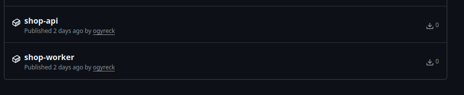

## Часть 1 - создание политик

Для управления политиками в кластере был выбран Kyverno, т. к. его политики больше похожи на обычное описание манифестов в кубере.

Для установки воспользуемся командой из [документации](https://kyverno.io/docs/installation/installation/). Ставим Kyverno v1.19.1 (Helm-чарт 3.9.1), версию чарта фиксируем явно.

``` bash
helm repo add kyverno https://kyverno.github.io/kyverno/
helm repo update
helm install kyverno kyverno/kyverno --version 3.9.1 -n kyverno --create-namespace
```

После чего напишем [файл с политиками](./politics/politics.yaml). Будем применять политики только к неймспейсу лабы, а не ко всему кластеру, т. к. в кластере могут использоваться внешние образы и манифесты, которые могут не следовать данным политикам (например, политике на определенный реджистри). Для этого используется тип политик `NamespacedValidatingPolicy`, а не `ValidatingPolicy`, который распространяется на весь кластер.

### Описание применяемых политик

#### 1. disallow-root (запрет запуска контейнеров от root)

Политика нужна, чтобы в неймспейс не попал образ, в котором есть контейнер, который крутится под root. Это очень опасная уязвимость, т. к. с ее помощью можно получить доступ от рута не в самом контейнере, а за его пределами и очень просто ломануть кластер, а этого мы не хотим.

#### 2. allowed-registry (образы только из личного GitHub ghcr.io/ogyreck/)

Следующей политикой является запрет пулинга образов в неймспейс из внешних недоверенных реджистри. Зачастую в корпоративной разработке запрещен пулинг образов не из своего реджистри, т. к. образы, которые туда попадают, либо собственного производства, либо прошли проверку ИБ. Все остальные образы из внешних реджистри по умолчанию считаются небезопасными. В этом правиле в качестве доверенного реджистри выступает мой личный GHCR.

#### 3. require-labels (обязательные лейблы)

Третья политика запрещает создавать поды без обязательных лейблов. Лейблы — это основной способ связать ресурс в кластере с его назначением: что за ресурс, к чему он относится, кто владелец (например, команда или человек). Для корректного прохождения правила нужны два лейбла: стандартный `app.kubernetes.io/name` с именем приложения и собственный `lab`, который говорит, что ресурс относится к лабе.

#### 4. require-resources (обязательные requests и limits)

Железо в кластере не бесконечное (особенно в домашнем), поэтому следует ограничивать ресурсы каждого приложения, чтобы не возникало ситуаций, когда ресурсы заканчиваются, например, из-за кривого приложения разработчика (часто с таким встречаюсь, и нужно постоянно это править, жаль, у нас на работе нет Kubernetes((( ).

Политика отклонит манифест, если в нем явно не прописаны ограничения по ресурсам.


#### 5. disallow-privilege-escalation (запрет privileged и повышения привилегий)

Пятая политика запрещает запускать контейнеры с расширенными правами. Контейнер с `privileged: true` получает почти полный доступ к ядру и устройствам ноды и в случае компрометации позволяет выйти за пределы контейнера и захватить весь узел. Параметр `allowPrivilegeEscalation` определяет, может ли процесс внутри контейнера получить больше прав, чем у родительского процесса.


#### Добавление autogen

Также во все политики добавлен autogen, который распространяет политику сразу на разные типы ресурсов:

``` yaml
autogen:
   podControllers:
     controllers: [deployments, statefulsets, daemonsets, jobs, cronjobs]
```

Применим политики с помощью команды:
``` bash
kubectl apply -f lab3-k8s-control-plane/politics/politics.yaml
```
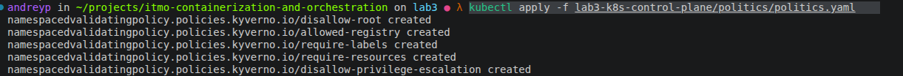


### Тестируем политики

А теперь тесты! Создал [5 манифестов](./politics/politic-test/), каждый нарушает одну политику. Будем пробовать запускать каждый и смотреть, что произойдет.

#### 1. Запуск от рута

Проверим политику disallow-root. В [манифесте](./politics/politic-test/no-root.yaml) специально выставим поле:

```yaml

securityContext:
    runAsUser: 0 # рут-пользователь
```
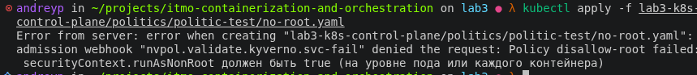

Правило сработало!

#### 2. Образы из левого реджистри

Проверим политику allowed-registry. В [манифесте](./politics/politic-test/imposter-image.yaml) специально будем тянуть образ:

```yaml
docker.io/library/nginx:1.27
```

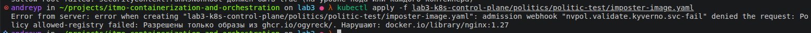

Правило сработало, огонь!

#### 3. Манифест без обязательных лейблов

Проверим политику require-labels. В [манифесте](./politics/politic-test/no-lables.yaml) уберем все лейблы:


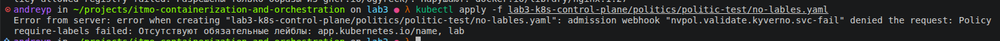

И это правило тоже сработало!

#### 4. Под без ограничений по ресурсам

Проверим политику require-resources. В [манифесте](./politics/politic-test/no-limits.yaml) уберем ограничения ресурсов:


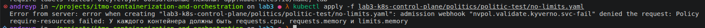

И это правило тоже сработало, огонь!

#### 5. Запускаем под с privileged: true

Проверим политику disallow-privilege-escalation. В [манифест](./politics/politic-test/mega-pod.yaml) добавим:
``` yaml
      securityContext:
        privileged: true
```

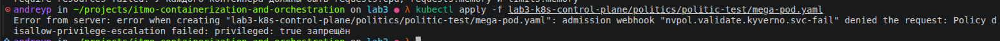

И это правило тоже сработало, огонь! Идем дальше.


### Часть 2 - Создание Chart, тестирование обновления

Итак, во второй части нужно создать Helm-чарт для приложения. Само приложение состоит из двух смысловых частей — api и worker. Переменные значения чарта будем указывать в [values.yaml](./helm/values.yaml). В [Chart.yaml](./helm/Chart.yaml) будет находиться общая информация о чарте.

Также создадим папку `templates`, в которой и будут описаны основные ресурсы: Deployment — для запуска и деплоя приложения и Service — для сетевой доступности.

Сам по себе чарт относительно стандартный. В нем учтены все политики из прошлой части. Также добавлен `nodeSelector.purpose: workload` для запуска на воркер-нодах. Подробнее про сам кластер можно [почитать вот тут](../generic/README.md). Для каждого сервиса (воркера и апи) написаны отдельные deployment и service. По своей сути они похожи, но есть несколько отличий:

1. Для корректного обновления в [api-deployment](./helm/templates/api-deployment.yaml) добавлено описание RollingUpdate:
```yaml
  strategy:
    type: RollingUpdate
    rollingUpdate:
      maxSurge: 1 # максимум новых подов сверх нужного количества
      maxUnavailable: 0 # сколько подов может быть недоступно во время обновления
```
2. В [api-service](./helm/templates/api-service.yaml) выставлен сетевой доступ через NodePort. Это позволит достучаться до приложения без проброса порта, просто из локальной сети. В то же время в [worker-service](./helm/templates/worker-service.yaml) используется просто ClusterIP — доступ только внутри кластера.


3. Также в [api-deployment](./helm/templates/api-deployment.yaml) прокинуты env для работы приложения.


#### Установка чарта

Для установки пропишем команду:

``` bash
helm install shop lab3-k8s-control-plane/helm/ -n lab3
```

Проверим установку:
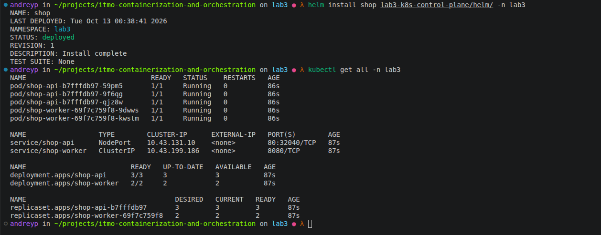

Все установилось успешно.

#### Удаление пода

Теперь удалим под руками и посмотрим, что произойдет:

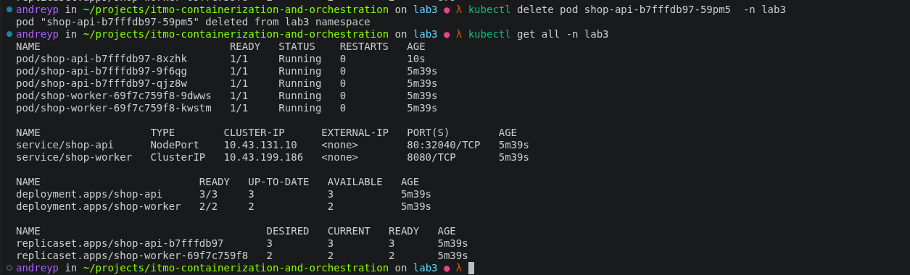

Под удалился, но Kubernetes, а именно control plane, тут же его восстановил, и количество реплик осталось прежним — 3.

#### Изменение количества реплик

Дальше изменим количество реплик в [values.yaml](./helm/values.yaml) в поле `api.replicaCount` с 3 на 4 и посмотрим, что произойдет:

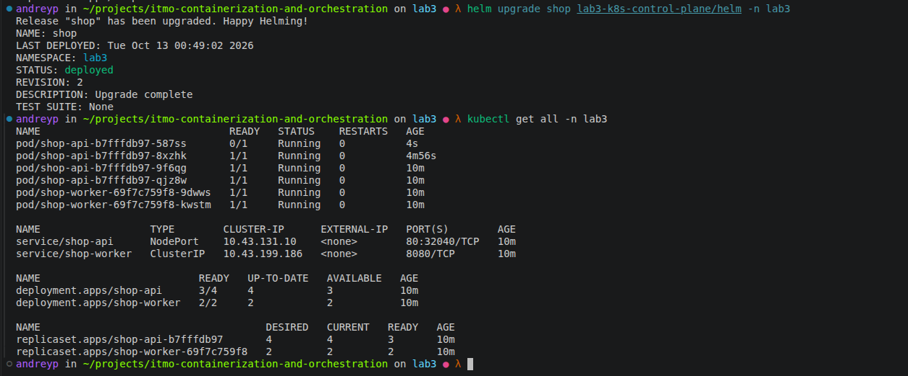

Количество увеличилось!

#### Обновление приложения без простоя

Теперь обновим приложение до версии 0.2.0 и будем в этот момент долбиться в `/health` и смотреть, что происходит:

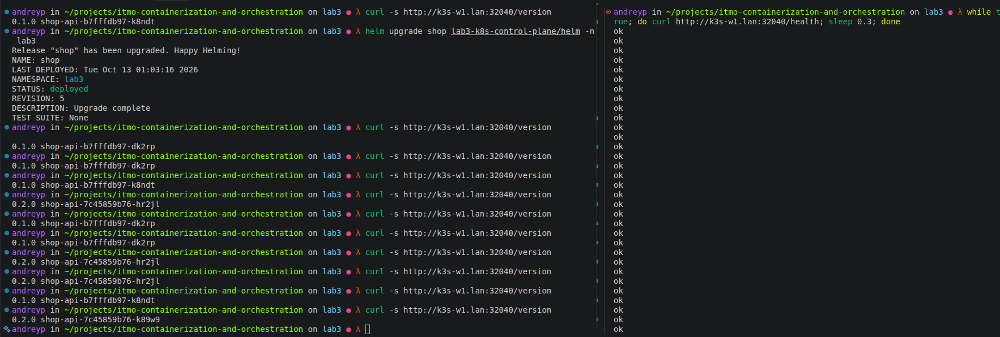

При обновлении можно заметить несколько интересных моментов:

1. Приложение не падает: во время всего обновления эндпоинт `/health` работал исправно и отвечал.

2. Само обновление происходило постепенно: Kubernetes поочередно поднимал новые поды с новой версией приложения (хорошо видно на скрине), направляя запросы то на старые версии, то на новые, пока полностью не обновил все поды.

#### Катим сломанный релиз Helm-чарта

Теперь делаем следующее: поднимаем версию чарта до `0.2.0` в [Chart.yaml](./helm/Chart.yaml) и выставляем переменную `HEALTH_FAIL=true`:

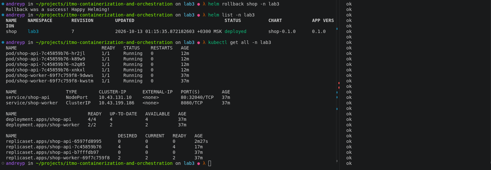

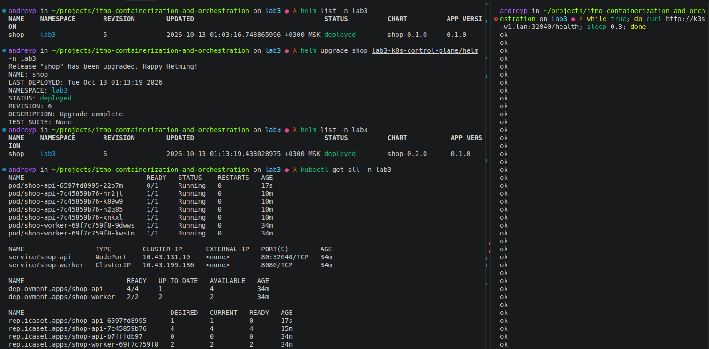

Видим интересную картину: во время обновления чарт создал под с неработающим `/health`, при этом старые поды он не удалял. И получается, что даже с неработающей новой версией наше приложение отвечает, оставаясь на старой версии. Очень классное свойство, которое дает безотказную работу. После роллбека мы откатились на старую версию, и приложение все так же продолжало работать.

### Часть 3 - добавление оператора для БД

В этой части нужно добавить оператор для работы с базой данных. Выбор пал на CloudNativePG. И тут сразу интересный момент. Вспоминаем часть 1, где мы настраивали политики: одна из них запрещает пулинг образов из неизвестных реджистри. Есть 2 способа решения:

1. Переписать политику и добавить реджистри CloudNativePG. Этот вариант простой, но нам не подходит, т. к. политики нужны, чтобы им следовать, а не нарушать их или переписывать.
2. Второй вариант более муторный, но зачастую так и делают — перепулить образы в свой реджистри и тянуть их уже не из внешних источников, а из доверенного репозитория. Наш вариант.

Для переноса образа можно использовать на локальной машине docker pull, docker tag и docker push. Или воспользоваться утилитой от Red Hat — skopeo. Она опенсорсная и позволяет удобно выполнять подобные задачи.

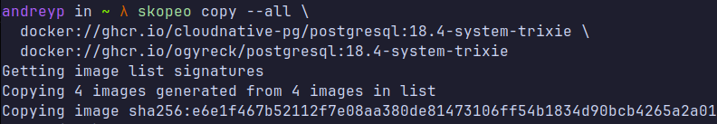
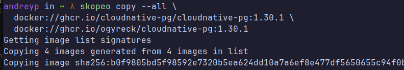
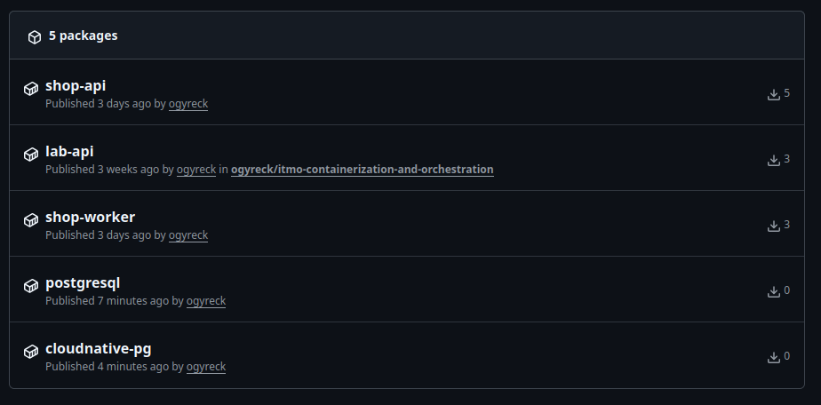

После чего установим оператор в кластер:
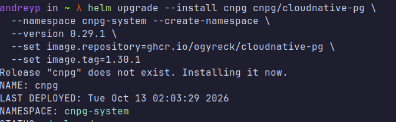

#### Написание шаблона для БД

После установки оператора можно переходить к написанию [шаблона для БД](./helm/templates/postgres-cluster.yaml). Учтем все ограничения из политик: лейблы, ресурсы. Образ для БД также будем брать из личного реджистри, а не тянуть из стороннего репозитория. Также добавим в шаблон создание базовой базы данных. Все переменные значения укажем в [values.yaml](./helm/values.yaml).

Также нам нужно связать приложение с БД. Для этого в [api-deployment.yaml](./helm/templates/api-deployment.yaml) пробросим секрет от БД в переменную:

```yaml
            - name: DATABASE_URL
              valueFrom:
                secretKeyRef:
                  name: {{ .Release.Name }}-pg-app
                  key: uri
```
Обновим чарт:

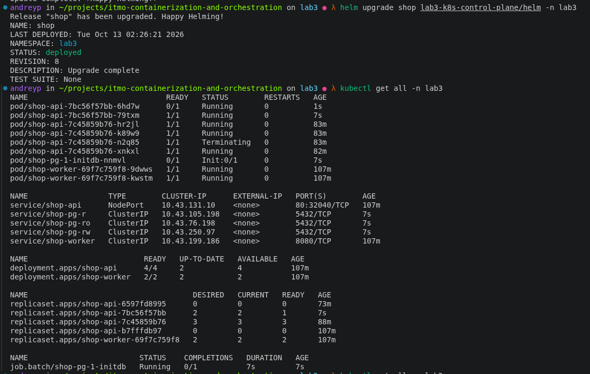
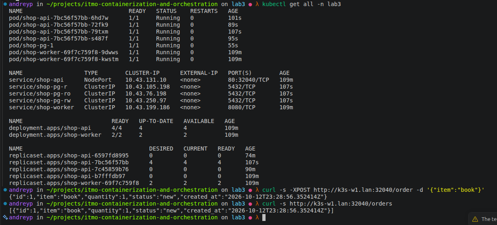

База данных успешно поднялась и работает!

#### Удалим под с БД

Попробуем удалить под с БД:
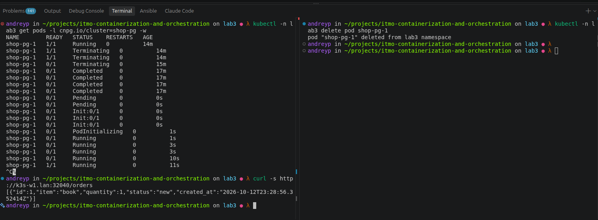

На скрине видно, что под удалился, после чего оператор создал его снова, т. к. мы не меняли манифест. При этом сохранились имя пода и все данные в базе данных.

#### Что создал оператор

На самом деле то, что мы написали, — это только упрощенная версия развертывания БД. Сам оператор взял значения, которые мы указали в шаблоне, и создал довольно сложный и большой манифест, который правильно и с учетом всех тонкостей разворачивает БД.

<details>
  <summary>Вывод kubectl -n lab3 get cluster -o yaml  </summary>

  ```yaml
apiVersion: v1
items:
- apiVersion: postgresql.cnpg.io/v1
  kind: Cluster
  metadata:
    annotations:
      meta.helm.sh/release-name: shop
      meta.helm.sh/release-namespace: lab3
    creationTimestamp: "2026-10-12T23:26:22Z"
    generation: 1
    labels:
      app.kubernetes.io/instance: shop
      app.kubernetes.io/managed-by: Helm
      app.kubernetes.io/name: shop-postgres
      lab: lab3
    name: shop-pg
    namespace: lab3
    resourceVersion: "7115075"
    uid: ac60b8f0-c542-4b61-861d-91e820527e7c
  spec:
    affinity:
      podAntiAffinityType: preferred
    bootstrap:
      initdb:
        database: shop
        encoding: UTF8
        localeCType: C
        localeCollate: C
        owner: shop
    enablePDB: true
    enableSuperuserAccess: false
    failoverDelay: 0
    imageName: ghcr.io/ogyreck/postgresql:18.4-system-trixie
    inheritedMetadata:
      labels:
        app.kubernetes.io/instance: shop
        app.kubernetes.io/name: shop-postgres
        lab: lab3
    instances: 1
    logLevel: info
    maxSyncReplicas: 0
    minSyncReplicas: 0
    monitoring:
      customQueriesConfigMap:
      - key: queries
        name: cnpg-default-monitoring
      disableDefaultQueries: false
      enablePodMonitor: false
    postgresGID: 26
    postgresUID: 26
    postgresql:
      parameters:
        archive_mode: "on"
        archive_timeout: 5min
        dynamic_shared_memory_type: posix
        full_page_writes: "on"
        log_destination: csvlog
        log_directory: /controller/log
        log_filename: postgres
        log_rotation_age: "0"
        log_rotation_size: "0"
        log_truncate_on_rotation: "false"
        logging_collector: "on"
        max_parallel_workers: "32"
        max_replication_slots: "32"
        max_worker_processes: "32"
        shared_memory_type: mmap
        shared_preload_libraries: ""
        ssl_max_protocol_version: TLSv1.3
        ssl_min_protocol_version: TLSv1.3
        wal_keep_size: 512MB
        wal_level: logical
        wal_log_hints: "on"
        wal_receiver_timeout: 5s
        wal_sender_timeout: 5s
      syncReplicaElectionConstraint:
        enabled: false
    primaryUpdateMethod: restart
    primaryUpdateStrategy: unsupervised
    probes:
      liveness:
        isolationCheck:
          connectionTimeout: 1000
          enabled: true
          requestTimeout: 1000
    replicationSlots:
      highAvailability:
        enabled: true
        slotPrefix: _cnpg_
      synchronizeReplicas:
        enabled: true
      updateInterval: 30
    resources:
      limits:
        memory: 512Mi
      requests:
        cpu: 100m
        memory: 256Mi
    smartShutdownTimeout: 180
    startDelay: 3600
    stopDelay: 1800
    storage:
      resizeInUseVolumes: true
      size: 1Gi
    switchoverDelay: 3600
  status:
    availableArchitectures:
    - goArch: amd64
      hash: 6d915657dadd72f66b0cdeca4d8f357d00de769bee14d4f6ea8adb501dab80d4
    - goArch: arm64
      hash: 37e47ffea358929899c8fd2b54139307934492108f5a0cde76e491248145fd4d
    certificates:
      clientCASecret: shop-pg-ca
      expirations:
        shop-pg-ca: 2027-01-10 23:21:22 +0000 UTC
        shop-pg-replication: 2027-01-10 23:21:22 +0000 UTC
        shop-pg-server: 2027-01-10 23:21:22 +0000 UTC
      replicationTLSSecret: shop-pg-replication
      serverAltDNSNames:
      - shop-pg-rw
      - shop-pg-rw.lab3
      - shop-pg-rw.lab3.svc
      - shop-pg-rw.lab3.svc.cluster.local
      - shop-pg-r
      - shop-pg-r.lab3
      - shop-pg-r.lab3.svc
      - shop-pg-r.lab3.svc.cluster.local
      - shop-pg-ro
      - shop-pg-ro.lab3
      - shop-pg-ro.lab3.svc
      - shop-pg-ro.lab3.svc.cluster.local
      serverCASecret: shop-pg-ca
      serverTLSSecret: shop-pg-server
    cloudNativePGCommitHash: 2a35abb46
    cloudNativePGOperatorHash: 6d915657dadd72f66b0cdeca4d8f357d00de769bee14d4f6ea8adb501dab80d4
    conditions:
    - lastTransitionTime: "2026-10-12T23:26:22Z"
      message: Cluster has been bootstrapped
      reason: BootstrapCompleted
      status: "True"
      type: Initialized
    - lastTransitionTime: "2026-10-12T23:27:17Z"
      message: A single, unique system ID was found across reporting instances.
      reason: Unique
      status: "True"
      type: ConsistentSystemID
    - lastTransitionTime: "2026-10-12T23:27:25Z"
      message: Cluster is Ready
      reason: ClusterIsReady
      status: "True"
      type: Ready
    - lastTransitionTime: "2026-10-12T23:27:16Z"
      message: Continuous archiving is working
      reason: ContinuousArchivingSuccess
      status: "True"
      type: ContinuousArchiving
    configMapResourceVersion:
      metrics:
        cnpg-default-monitoring: "7114401"
    currentPrimary: shop-pg-1
    currentPrimaryTimestamp: "2026-10-12T23:27:16.327756Z"
    healthyPVC:
    - shop-pg-1
    image: ghcr.io/ogyreck/postgresql:18.4-system-trixie
    instanceNames:
    - shop-pg-1
    instances: 1
    instancesReportedState:
      shop-pg-1:
        ip: 10.42.1.46
        isPrimary: true
        timeLineID: 1
    instancesStatus:
      healthy:
      - shop-pg-1
    managedRolesStatus: {}
    operatorCertificateFingerprint: 0748b266c675e569c33c8026d608710c12a95a18f08aa40df8a8ca436556807f
    pgDataImageInfo:
      image: ghcr.io/ogyreck/postgresql:18.4-system-trixie
      majorVersion: 18
    phase: Cluster in healthy state
    poolerIntegrations:
      pgBouncerIntegration: {}
    pvcCount: 1
    readService: shop-pg-r
    readyInstances: 1
    secretsResourceVersion:
      applicationSecretVersion: "7114378"
      clientCaSecretVersion: "7114373"
      replicationSecretVersion: "7114377"
      serverCaSecretVersion: "7114373"
      serverSecretVersion: "7114374"
    selector: cnpg.io/cluster=shop-pg,cnpg.io/podRole=instance
    switchReplicaClusterStatus: {}
    systemID: "7695926976586502164"
    targetPrimary: shop-pg-1
    targetPrimaryTimestamp: "2026-10-12T23:26:22.762618Z"
    timelineID: 1
    topology:
      instances:
        shop-pg-1: {}
      nodesUsed: 1
      successfullyExtracted: true
    writeService: shop-pg-rw
kind: List
metadata:
  resourceVersion: ""
  ```

</details>


#### Сравнение controller-manager и оператора

И то и другое — контроллеры, работающие с объектами, у которых есть `spec` — желаемое состояние — и `status` — текущее. И соответственно через API они стараются привести систему в нужное состояние. Но оператор больше адаптирован под конкретные задачи. Например, если бы мы устанавливали базу данных с помощью controller-manager, то при удалении он пересоздал бы под с новым именем, и ему было бы все равно, какие данные были до этого. В то время как оператор создал под с точно таким же именем, подключил то же хранилище с данными и привел кластер в нужное состояние, не потеряв данные.


### Часть 4 - Отключаем control plane

Итак, следующая часть — отключение CP. Т. к. кластер располагается на разных нодах и сам control plane вынесен на отдельную ноду, будем стопать на ней процесс k3s (в нем же находятся etcd и apiserver). По идее само приложение продолжит работу, т. к. на нодах крутятся агенты k3s, и они должны продолжить свою работу. Но, возможно, у нас перестанет работать внутренний DNS, и часть запросов перестанет проходить. Посмотрим на практике.

На всякий случай сделаем снапшот, перед тем как что-то ломать:

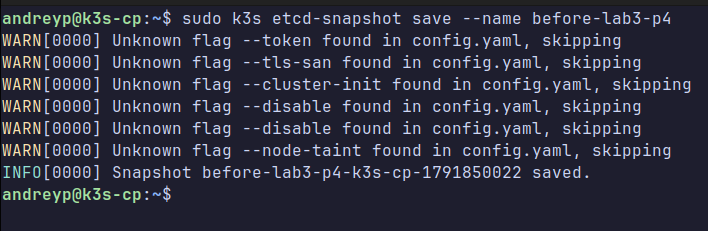

Для проверки работоспособности кластера напишем [скрипт](./scripts/load.sh), который будет дергать ручки приложения.

Остановим CP с помощью команды `sudo systemctl stop k3s`:

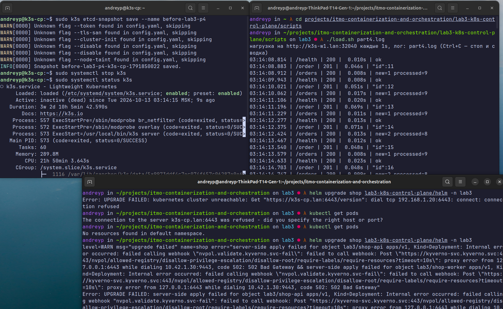

В этот момент приложение полностью работает, все запросы выполняются, проблем с работоспособностью и доступностью не наблюдается. При этом доступа к helm, kubectl и прочим вещам нет.

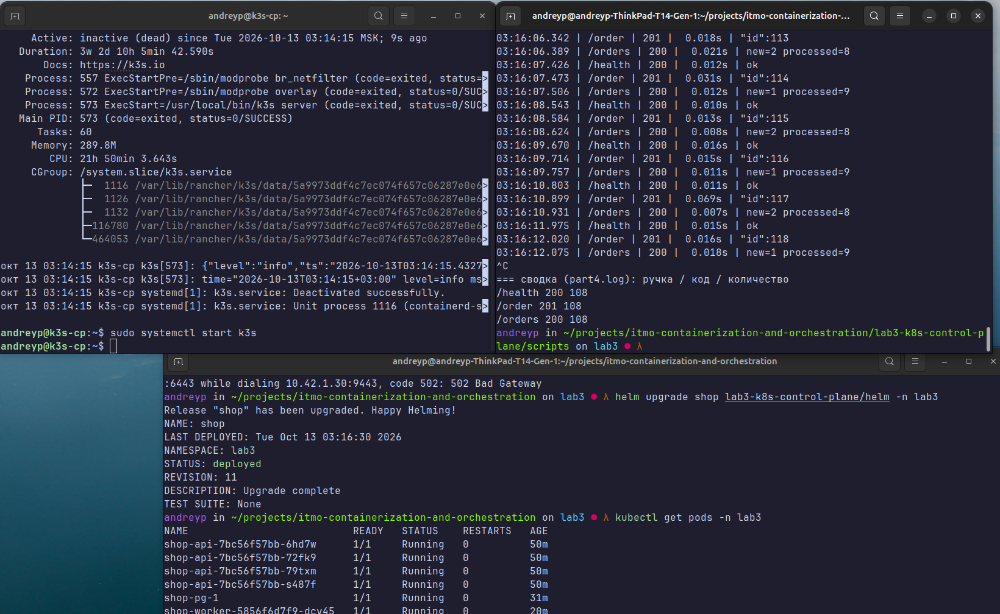

После чего мы снова запустили CP: приложение все так же работало, и появился доступ к управлению кластером. Также в [логе](/lab3-k8s-control-plane/scripts/part4.log) видно, что не было ни одной ошибки и все запросы обработались.

### Часть 5 - Мониторинг

Для начала создадим два шаблона: [worker-servicemonitor.yaml](./helm/templates/worker-servicemonitor.yaml) и [api-servicemonitor.yaml](./helm/templates/api-servicemonitor.yaml). Они нужны для сбора метрик с эндпоинта `/metrics` на порту http. Также создадим алерты в манифесте [prometheusrule](./helm/templates/prometheusrule.yaml). Обязательно укажем лейбл `release: kps`, чтобы Prometheus подтянул алерты.

#### 3 алерта:

1. **ShopApiHighErrorRate** — доля 5xx на бизнес-ручках, с исключением `/health`. Нужен для того, чтобы понимать, сколько было ошибок.
2. **ShopApiHighLatency** — p95 латентности бизнес-ручек: сервис отвечает, но медленно.
3. **ShopWorkerStalled** — worker давно не завершал успешный цикл опроса БД. Нужен для контроля бизнес-логики приложения и проблем с обработкой заказов.

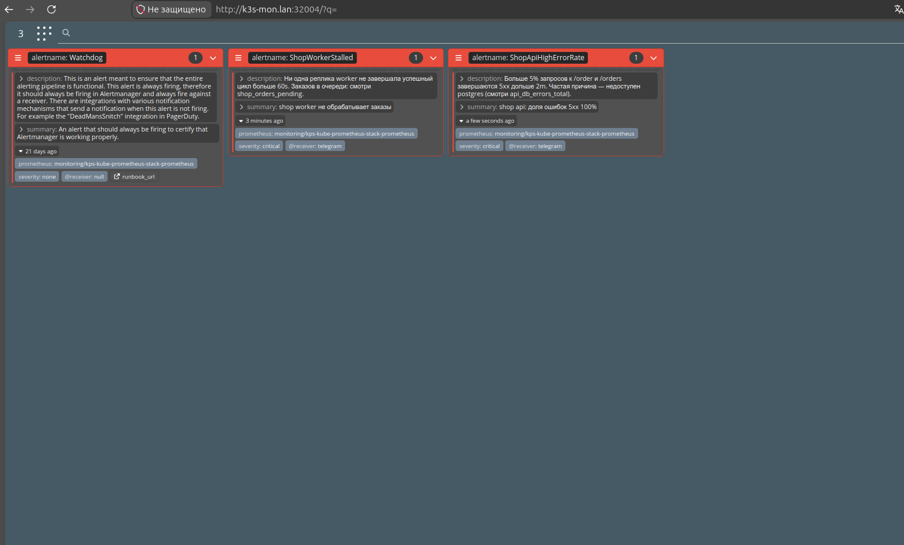

#### Дашборд

Дашборд взял из второй лабы и немного адаптировал под текущие метрики. Также добавил его в репозиторий, и через [ConfigMap](./helm/templates/dashboard.yaml) он добавляется в Grafana.

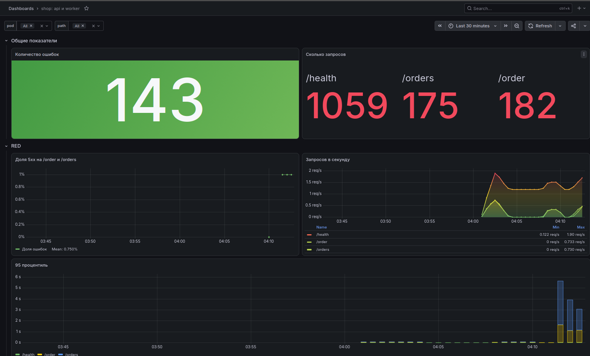
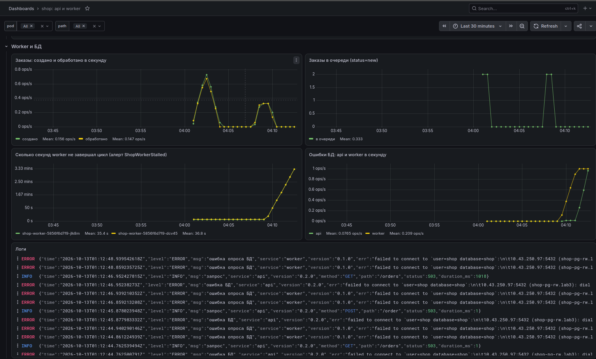
