# Лаба 4 — SLA критического пути под перегрузкой

В данной работе нужно настроить кластер так, чтоб под нагрузкой сохранялся SLA у критических сервисов.

Описание лабы — [ссылка](https://github.com/KeladKaal/containerization-and-orchestration/blob/main-rus/lecture-4-scheduling-resources/lab.md)

## Часть 0 - создания сервиса batch 

И так создадим сервис batch, который будет нагружать наш кластер,  и с помощью него будем смотреть на нагрузку. [Папка с сервисом](./batch). И также, по классике, запушем образ в личный Github реджистари:

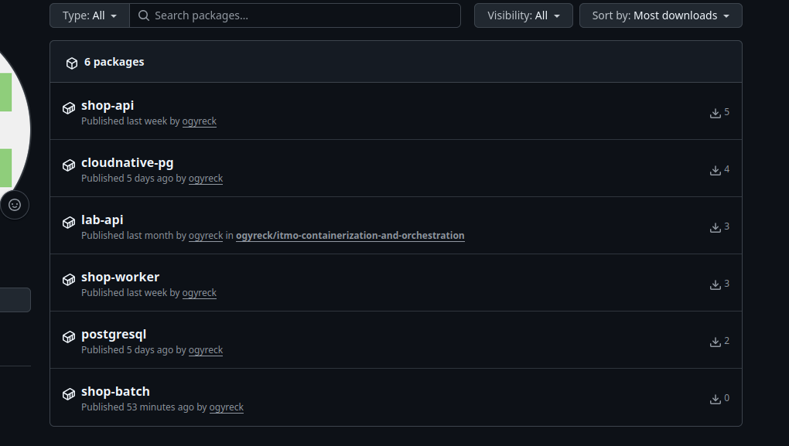

## Часть 1 - выбор механиз разнесения

Сейчас в кластере реализован механизм `NodeAffinity`, который позволяеят определдить под -> нода. Оно позволяет держать мониторинг на одной ноде, а приложения на двух других. Для лабораторной работы нужно выбрать другое правило, которое будет свзявыать под -> другие поды. Есть два варианта: `podAntiAffinity` и `topologySpreadConstraints`. Сейчас у нас должно быть 4 реплики приложения апи, поэтому по нему посмотрим на эти механизмы:

- #### anti-affinity
    4 реплики, NodeSelector оставит 2 ноды(w1, w2). Хочется чтоб поды равномерно распределились по нодам
    - `requiredDuringSchedulingIgnoredDuringExecution` -  первая реплика встаёт на w1, вторая на w2. Остальные повиснят в `Pending` - **не подходит**
    - `preferredDuringSchedulingIgnoredDuringExecution` - мегкое правило, все поды встанут. Но нет гарантии, что они распределятся равномерно. Мождет произойти, что на первой ноде будет 3, а на 2 - 1. -  **не подходит**
- #### TopologySpreadConstraints
    Можно более гибко настроить. Выставим параметр `maxSkew: 1` с `DoNotSchedule`. Максимальный перекос 1. Изначально разместит  2 пода на w1 и 2 пода на w2. - **подходит**. При обновлении кубер создат еще один под. Всего их будет 5(распредление будет [3,2]). И обновление также пройдет успешно. 

## Часть 2 - Тесная площадка

Для разворачивания будем использовать тот же кластер, который настраивали в 3 лабе. Поды с `batch` поедут на нодах `purpose=workload`. Для работы скопируем хелм чарт из 3 лабы и будем его дорабатывать. 


Допишем в [values.yaml](./helm/values.yaml) перменные для `batch`, и также добавим темплейт [`batch-deployment.yaml`](./helm/templates/batch-deployment.yaml) для его разворачивания. после чего обновим чарт в кластере:

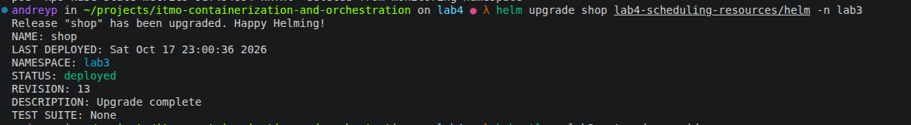
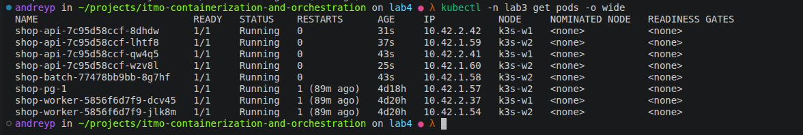

## Часть 3 - Реальные цифры вместо догадок

### Нагрузка

Чтобы `krr` было что анализировать, сначала нагрузим путь заказа. Для этого напишем [сценарий k6](./load/order.js). k6 держит заданный RPS независимо от того, как быстро отвечает сервис, поэтому деградация видна как рост latency и ошибок, а не как просевший RPS. Профиль 40 минут: разгон, спокойный фон, пик, почти простой и второй пик. Перепады нужны, потому что krr для CPU берёт перцентиль, а для памяти максимум, и на ровной нагрузке разницу между ними не увидеть. 90% запросов — `POST /order` (критический путь), 10% — `GET /orders`.

```bash
PEAK_RPS=400 k6 run load/order.js
```

Итог прогона: 524 675 запросов (219 RPS в среднем, пик 400), ошибок 0%, p95 `POST /order` = 17 ms.


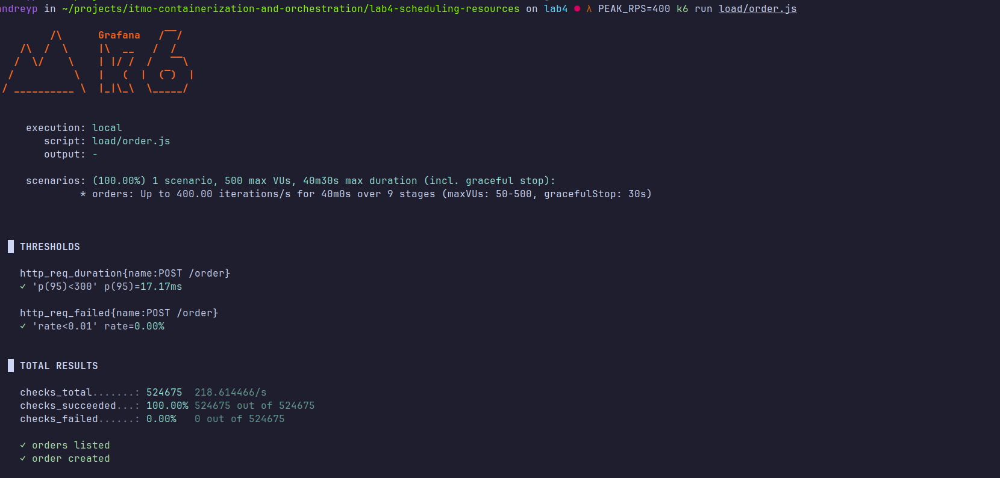

### krr

Запускаем `krr` по namespace, ограничив историю последним часом, то есть окном с нагрузкой. Иначе в расчет попадут дни простоя:


```bash
krr simple -n lab3 -p http://k3s-mon.lan:32001 --history_duration 1 --points_required 20 --mem-min 0 --cpu-min 0
```


Стратегия `simple` считает так:

| | request | limit |
|---|---|---|
| CPU | 95-й перцентиль `container_cpu_usage_seconds_total` | не ставит |
| Memory | max `container_memory_working_set_bytes` + 15% | = request |

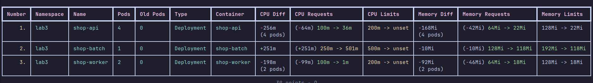

### postgres

`postgres` в отчёт не попал. Под `shop-pg-1` принадлежит `Cluster` от CNPG , а krr ищет нагрузку только среди стандартных объектов . Поэтому посчитаем по тому же алгоритму вручную в Prometheus:

```promql
# CPU request: p95 от rate за последний час
quantile_over_time(0.95,
  rate(container_cpu_usage_seconds_total{namespace="lab3",pod="shop-pg-1",container="postgres"}[2m])[1h:1m])

# Memory: max working set за час (+15% добавляем сами)
max_over_time(container_memory_working_set_bytes{namespace="lab3",pod="shop-pg-1",container="postgres"}[1h])
```

Получилось: CPU p95 около 130m, working set max около 220Mi, то есть с буфером ≈ 253Mi. основную часть working set у postgres составляют страницы page cache и `shared_buffers`, а не память процессов. Значит, эта цифра растет вместе с объемом данных, а не с RPS.

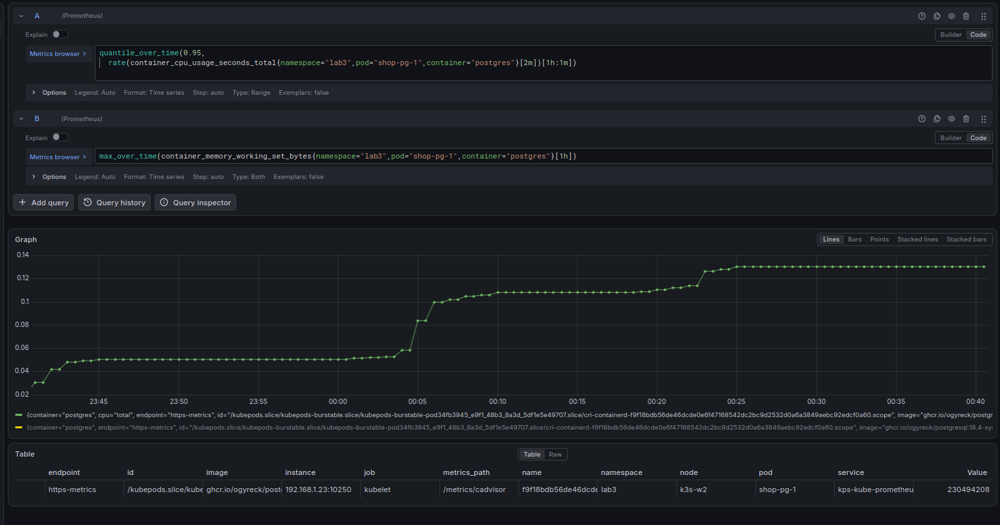

### Оценка против рекомендаций

| Сервис | Ресурс | Исходная оценка (request / limit) | Рекомендация | Разница |
|---|---|---|---|---|
| `api` | CPU | 100m / 200m | 36m / — | завышено ≈ ×3 |
| `api` | Memory | 64Mi / 128Mi | 22Mi / 22Mi | завышено ≈ ×3 |
| `worker` | CPU | 100m / 200m | 1m / — | завышено ×100 |
| `worker` | Memory | 64Mi / 128Mi | 18Mi / 18Mi | завышено ≈ ×3.5 |
| `postgres` | CPU | 100m / — | 130m / — | **занижено** ≈ ×1.3 |
| `postgres` | Memory | 256Mi / 512Mi | 253Mi / 253Mi | request почти совпал |
| `batch` | CPU | 250m / 500m | 501m / — | данные обрезаны лимитом |

Откуда разрыв:

- **Оценка была одинаковой для всех сервисов**, а профили потребления у них разные. `api` и `worker` на Go держат 10–20Mi, а 64/128Mi — просто "круглые» числа с запасом.
- **`postgres` — единственный, кто недооценён по CPU.** Именно на него ложится каждый `POST /order`. А по памяти у него в working set сидит page cache, поэтому «на глаз» угадать его заранее нельзя.


### Что ставим в values.yaml

| Сервис | CPU request / limit | Memory request / limit |
|---|---|---|
| `api` | 50m / 100m | 48Mi / 48Mi |
| `worker` | 10m / 50m | 40Mi / 40Mi |
| `postgres` | 150m / — | 256Mi / 512Mi |

- **Память `api` и `worker` - *2 от рекомендации.** krr считал максимум за час на одном профиле нагрузки. Go может раздуть кучу вдвое между сборками мусора, а `GET /orders` растёт вместе с таблицей. С 22Mi под упадёт в OOMKilled, как только память выйдет на 15% выше уже виденного пика. Часовое окно не увидело ни холодный старт, ни рост данных, ни нагрузку выше 400 RPS.
- **Почему для CPU перцентиль, а для памяти максимум.** Если CPU не хватает, сервис просто замедляется. Если не хватает памяти, его убивают. Поэтому память считаем по максимуму. Если поменять местами, по памяти получим OOMKilled как раз на пиках, а по CPU будем держать ядра под редкие всплески, и они почти всё время будут простаивать.
- **CPU limit для Guaranteed.** krr limit не даёт, а брать его от p95 нельзя: ядро режет CPU кусками по 100 ms, и на каждом всплеске сервис будет троттлиться. Берём максимум за час с запасом ×1.5–2 и ставим request равным limit.

- **`postgres`.** CPU 150m — это p95 130m с запасом. Limit не ставим, чтобы не тормозить базу на критическом пути. Память: request 256Mi по замеру. Limit оставляем 512Mi: самому процессу нужно всего 68Mi, остальное — page cache, который ядро освободит само, и `shared_buffers`, которые освободить нельзя, так что их limit должен покрывать.


## Часть 4 - разнеси критический сервис

Для того чтоб `api` работал на равномерно на разных нодах, добавим в манифест `topologySpreadConstraints`, описанный в часте 1:

```yml
      topologySpreadConstraints:
        - maxSkew: {{ .Values.api.spread.maxSkew }}
          topologyKey: {{ .Values.api.spread.topologyKey }}
          whenUnsatisfiable: {{ .Values.api.spread.whenUnsatisfiable }}
          nodeTaintsPolicy: {{ .Values.api.spread.nodeTaintsPolicy }}
          labelSelector:
            matchLabels:
              app.kubernetes.io/name: shop-api
              app.kubernetes.io/instance: {{ .Release.Name }}
          matchLabelKeys:
            - pod-template-hash
```

Проверка подов:

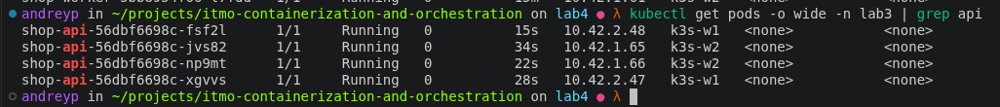

Эта настройка позволяет повысить отказа устойчивость: если одна нода выйдет из строя, у нас гарантировано есть поды на другой ноде.

## Часть 5 - приоритеты и гарантии
Сейчас все поды Burstable с priority 0, и под давлением ресурсов кластер не отличает `api` от `batch`. Добавим в чарт три вещи: классы приоритета, QoS через requests/limits и PDB.

**Классы приоритета** ([`priorityclasses.yaml`](./helm/templates/priorityclasses.yaml)), задаются в `values.yaml` → `priorityClasses`:

| Класс | Значение | preemptionPolicy | Кому |
|---|---|---|---|
| `shop-high` | 100000 | PreemptLowerPriority | `api`, `postgres` |
| `shop-normal` | 10000 | PreemptLowerPriority | `worker` |
| `shop-sacrificial` | -1000 | Never | `batch` |

`PriorityClass` - объект уровня кластера, поэтому к имени добавлен префикс релиза. `globalDefault: false`: поды без класса не должны молча становиться приоритетными. `batch` с `preemptionPolicy: Never` сам никого не вытесняет, а только ждёт свободного места. Значение у него отрицательное, и это сознательно. Сначала был класс `shop-low` со значением 1000, но у всех подов без класса (Kyverno, node-exporter, оператор CNPG) приоритет 0, и жертвуемая нагрузка оказалась **выше** системных компонентов. К чему это привело, видно в части 6. Поле `value` у PriorityClass неизменяемое: число записывается в `pod.spec.priority` при создании пода. Поэтому завели новый класс, а не правили старый.

**QoS:**

| Сервис | requests | limits | QoS |
|---|---|---|---|
| `api` | 100m / 48Mi | 100m / 48Mi | Guaranteed |
| `postgres` | 300m / 512Mi | 300m / 512Mi | Guaranteed |
| `worker` | 50m / 40Mi | 50m / 40Mi | Guaranteed |
| `batch` | 20m / 64Mi | 64m / 118Mi | Burstable |

Guaranteed требует requests = limits по CPU и памяти у **каждого** контейнера пода, включая init. Под postgres CNPG копирует `resources` из `Cluster` в init-контейнер `bootstrap-controller`, так что настраивать его отдельно не нужно. Из-за Guaranteed у postgres появился CPU limit (в части 3 мы его не ставили): без него Guaranteed не бывает. Значение взято с запасом над p95 (130m), чтобы база не упиралась в квоту.

**PDB.** Для `api` - [`api-pdb.yaml`](./helm/templates/api-pdb.yaml) с `maxUnavailable: 1`: при drain за раз уходит не больше одной реплики из четырёх. Для postgres свой PDB не делаем: CNPG уже создаёт `shop-pg-primary`. Два PDB на один под ломают Eviction API, и `kubectl drain` на таком поде зависает.

### Что это даёт под давлением

- **Приоритет работает в планировщике.** Если высокоприоритетному поду не хватает места, планировщик вытесняет (preemption) поды с более низким приоритетом.
- **PDB защищает только от «добровольных» выселений** через Eviction API (`kubectl drain`). При preemption планировщик лишь старается его не нарушать. При node-pressure eviction kubelet на PDB не смотрит совсем.
- **QoS работает на ноде** и влияет на то, кого выселят или убьют первым, когда память кончается.

### Burstable и Guaranteed в порядке выселения

Здесь два разных механизма:

1. **kubelet (node-pressure eviction).** Срабатывает при пересечении порога, например `memory.available`. Kubelet сортирует поды по трём признакам: превышает ли потребление requests, затем по priority, затем по тому, насколько сильно превышает. Guaranteed по определению не может превысить requests, ведь limit = request. Поэтому Burstable `batch`, который вылез за свои 64Mi, да ещё с низким приоритетом, уходит первым.
2. **Ядро (OOM killer).** Срабатывает, если kubelet не успел. Жертву ядро выбирает по `oom_score_adj`, который kubelet выставляет по QoS: Guaranteed `-997` (почти неубиваем), Burstable от 2 до 999 (чем меньше request относительно памяти ноды, тем выше).

### Результат

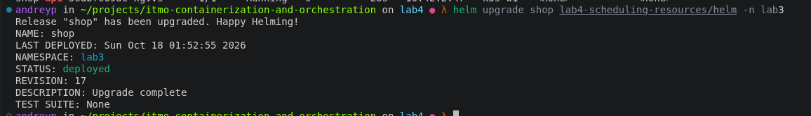
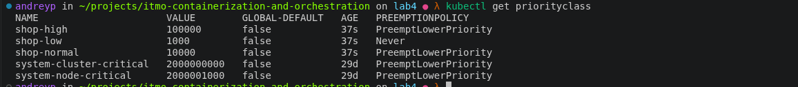
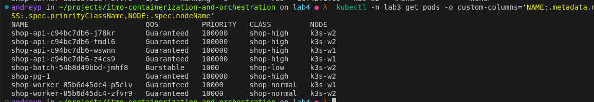
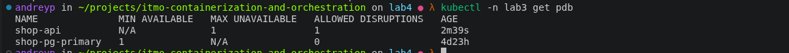

## Часть 6 - Нехватка ресурсов и preemption

Чтобы показать, что планировщик считает по requests, а не по факту, на время этой части сделаем у `batch` большой резерв и маленькое реальное потребление: `requests.memory: 256Mi` при `load.memoryMB: 16`. QoS остаётся Burstable (limit 512Mi).

Перед этим на воркерах включили порог `memory.available<300Mi` и `system-reserved=memory=256Mi` (через [Ansible](../generic/ansible/inventory/k3s/inventory.yml)). k3s задаёт свой `eviction-hard` только по диску, и дефолтный порог по памяти пропадает. После этого allocatable воркера уменьшился с ~2.4Gi до ~1.9Gi: планировщик видит меньше памяти, чем есть на ноде.

### Pending

Поднимаем `batch.replicaCount` до 8 и делаем `helm upgrade`. Часть реплик встаёт, остальные висят в `Pending`:

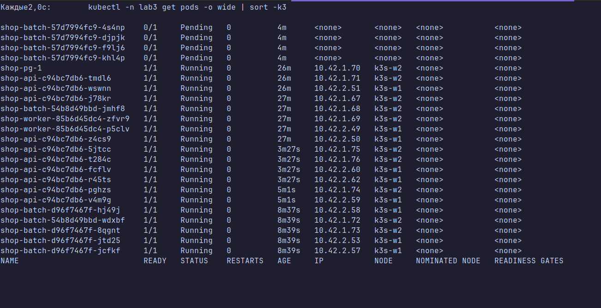

```
0/4 nodes are available: 2 Insufficient memory, 2 node(s) had untolerated taint(s).
preemption: not eligible due to preemptionPolicy=Never.
```

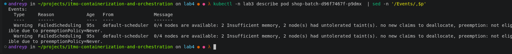
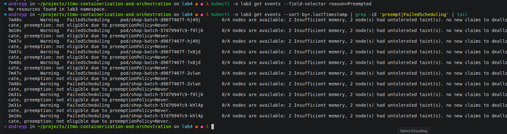

- `2 node(s) had untolerated taint(s)` — это `k3s-cp` и `k3s-mon`, сюда `batch` не пускают taint и `nodeSelector`.
- `2 Insufficient memory` — на воркерах кончилась память **по requests**.
- `preemption: not eligible due to preemptionPolicy=Never` — у класса `batch` запрещено вытеснять других, поэтому `batch` просто ждёт, хотя рядом стоят поды с меньшим приоритетом.

Главное видно на ноде. По requests память занята на 86–97%, а реально используется около половины:

| | requests memory | реально (`kubectl top`) |
|---|---|---|
| `k3s-w1`, 8 реплик | 1658Mi (86%) | 964Mi (50%) |
| `k3s-w1`, после роста `api` | 1866Mi (97%) | 1053Mi (55%) |

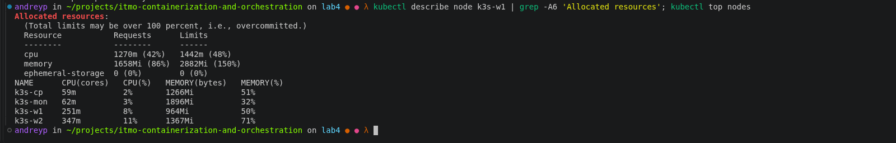
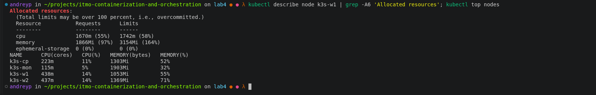

Планировщик не смотрит на реальное потребление: он складывает requests уже размещённых подов и сравнивает с allocatable. Под с request 256Mi «не влезает», хотя по факту на ноде свободно почти 1Gi. Это и есть цена завышенных requests: место зарезервировано, но не используется.

### Preemption

Поднимаем `api.replicaCount` до 10 и делаем `helm upgrade`. Все 10 реплик `api` встали (`shop-high`, 100000), но вытеснили они **не `batch`, а Kyverno**:

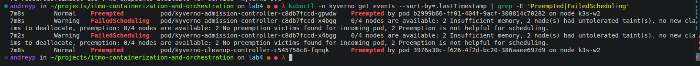

При preemption планировщик выбирает на ноде жертв с **самым низким** приоритетом. У подов Kyverno приоритет 0: класс им не задавали. Это ниже, чем у `batch` (1000). Поэтому под нож пошли `kyverno-admission-controller` и `cleanup-controller`.

Дальше получилась взаимная блокировка:

1. Новый под admission-контроллера (request 128Mi) встать не может: `Insufficient memory`. Сам вытеснить никого не может: приоритет 0 ниже всех.
2. Webhook Kyverno настроен с `failurePolicy: Fail`. Без живого контроллера apiserver отклоняет любое создание и изменение Deployment и подов.
3. Обратный `helm upgrade` тоже падает: `failed calling webhook "nvpol.validate.kyverno.svc-fail" … no endpoints available for service "kyverno-svc"`.

Выбрались через `kubectl scale`: webhook проверяет `deployments` и `pods`, но не подресурс `deployments/scale`. Уменьшили `batch` до 0 и `api` до 4. `batch` пришлось убрать тоже: его Pending-поды (1000) стоят в очереди планировщика раньше Kyverno (0) и заняли бы освободившееся место первыми.

Вывод: приоритеты действуют на весь кластер, а не на один namespace. Всё, без чего не работает admission, должно стоять выше любого приложения:

```bash
helm upgrade kyverno kyverno/kyverno -n kyverno --version 3.9.1 --reuse-values \
  --set global.priorityClassName=system-cluster-critical
```

После этого у подов Kyverno приоритет 2000000000, а `batch` перевели в класс `shop-sacrificial` (-1000), ниже всех подов без класса. Теперь при нехватке места первым кандидатом в жертвы будет именно `batch`.

## Часть 7 - Давление по памяти


### OOMKilled по собственному лимиту

Сначала контрольный опыт: `batch` хочет больше своего лимита.

```yaml
batch:
  load:
    memoryMB: 1500
  resources:
    requests: { memory: 256Mi }
    limits:   { memory: 512Mi }
```

Контейнер дорастает до 512Mi, и его убивает ядро: OOM killer внутри cgroup контейнера. Код выхода 137, `Reason: OOMKilled`. Под остаётся на месте, kubelet перезапускает контейнер, растёт `restartCount`, затем начинается `CrashLoopBackOff`. При этом у всех нод `MemoryPressure=False`, соседи ничего не заметили.

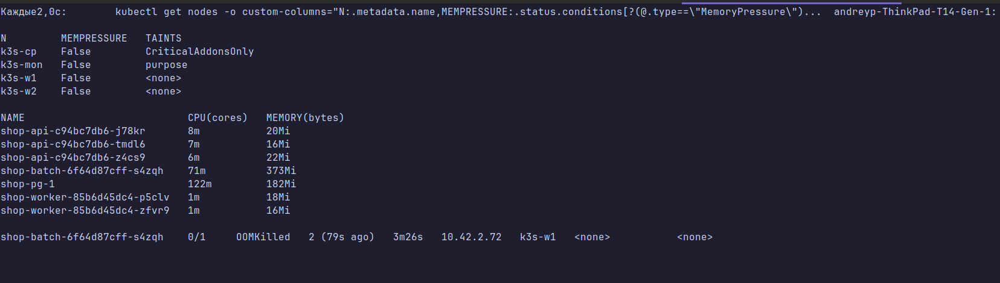
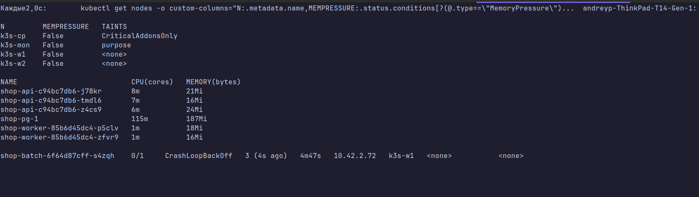
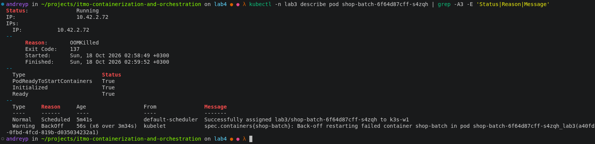

### Eviction при давлении на ноде

Теперь лимит выше потребления, и память кончается на **ноде**, а не в контейнере:

```yaml
batch:
  priorityClass: sacrificial   # -1000
  load:
    memoryMB: 1500
    memoryStepMB: 16
    memoryStepPeriod: 2s       # медленный рост, чтобы kubelet успел раньше ядра
  resources:
    requests: { memory: 256Mi }
    limits:   { memory: 2Gi }
```

Когда `batch` дорос до ~1.6Gi, свободной памяти на `k3s-w1` осталось меньше порога. Нода получила `MemoryPressure=True` и taint `node.kubernetes.io/memory-pressure`:

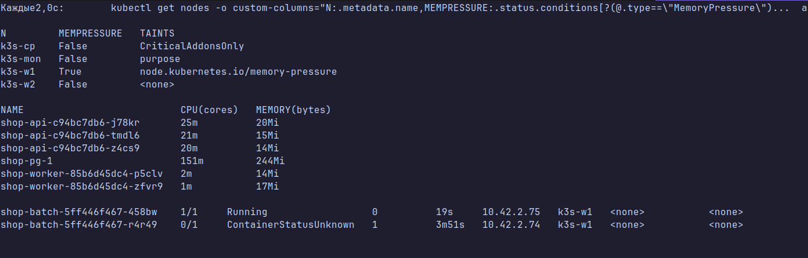

Kubelet выселил `batch`:

```
The node was low on resource: memory. Threshold quantity: 300Mi, available: 264112Ki.
Container shop-batch was using 1694168Ki, request is 256Mi, has larger consumption of memory.
```

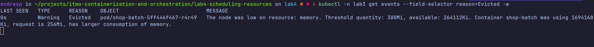
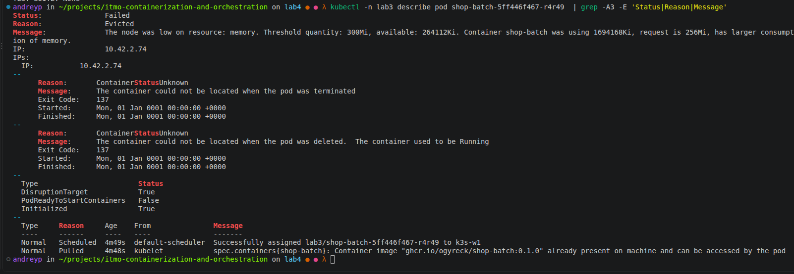

Под в статусе `Failed / Evicted`, а `api`, `postgres` и `worker` (Guaranteed) работают без единого рестарта:

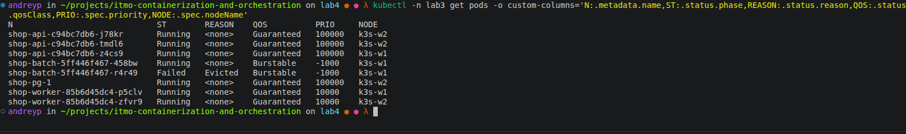

Почему первым ушёл именно `batch`:

1. Kubelet сначала берёт поды, у которых потребление **превышает requests**. У `batch` 1.6Gi при request 256Mi. Guaranteed-поды превысить requests не могут: у них limit = request.
2. Среди них выбирает с наименьшим **priority**. У `batch` -1000, ниже всех на ноде, включая node-exporter и оператор CNPG (0, BestEffort). С прежним значением 1000 первыми выселили бы их.
3. Затем смотрит, **насколько** превышен request. У `batch` разница самая большая.

Deployment сразу создал новый `batch`. Он снова встал на `k3s-w1` (на скрине i17 он Running 19 с) — по всей видимости, успел до того, как появился taint. Kubelet не отклоняет Burstable-поды при MemoryPressure, отказ при пуске получают только BestEffort. Поэтому дальше цикл «вырос → выселен» повторяется, пока `memoryMB` не вернули к 16.

### Eviction и OOMKilled — один симптом, два диагноза

В обоих случаях под «умер из-за памяти», но причины и механизмы разные:

| | Node-pressure eviction | OOMKilled по своему лимиту |
|---|---|---|
| Кто убивает | kubelet | ядро (OOM killer внутри cgroup контейнера) |
| Когда | на **ноде** кончается память (`memory.available` < порога) | **контейнер** упёрся в свой `limits.memory` |
| Кого | выбирает kubelet: превысил ли requests, затем priority, затем насколько превысил | только этот контейнер, соседи не при чём |
| Что с подом | под `Failed`, `reason: Evicted`, контроллер создаёт новый | под жив, контейнер перезапускается, `lastState.terminated.reason: OOMKilled`, растёт `restartCount` |
| Состояние ноды | `MemoryPressure=True`, taint `node.kubernetes.io/memory-pressure:NoSchedule` | нода в порядке, `MemoryPressure=False` |
| Что чинить | ёмкость ноды и requests соседей (overcommit) | лимит или потребление самого сервиса |

## Часть 8 - SLA под нагрузкой

**SLA: 95% запросов `POST /order` быстрее 250 ms, доля 5xx меньше 1% — даже при нехватке ресурсов.**

Граница 250 ms выбрана по бакету гистограммы `api_request_duration_seconds` (бакеты 0.1, 0.25, 0.5…). На границе бакета доля «быстрее 250 ms» считается точно, а значение между бакетами (например, 300 ms) `histogram_quantile` только интерполирует.

Нагрузка — тот же [сценарий k6](./load/order.js), запущенный фоном на время экспериментов:

```bash
PEAK_RPS=200 k6 run load/order.js | tee load/k6-overload.log
```

Проверка SLA в Prometheus:

```promql
# доля заказов быстрее 250 ms
sum(rate(api_request_duration_seconds_bucket{namespace="lab3",path="/order",le="0.25"}[1m]))
  / sum(rate(api_request_duration_seconds_count{namespace="lab3",path="/order"}[1m]))

# доля 5xx
sum(rate(api_requests_total{namespace="lab3",path="/order",status=~"5.."}[1m]))
  / sum(rate(api_requests_total{namespace="lab3",path="/order"}[1m]))

# деградация batch и доступность api
sum by (phase) (kube_pod_status_phase{namespace="lab3",pod=~"shop-batch.*"})
kube_deployment_status_replicas_available{namespace="lab3",deployment=~"shop-(api|batch)"}
```

### Часть 6 под нагрузкой (02:09–02:25)

| Метрика | Значение | SLA |
|---|---|---|
| Заказов `POST /order` | ~65 000, до 179 RPS | |
| p95, максимум по минутам | 96 ms (в среднем 30 ms) | < 250 ms ✓ |
| Доля быстрее 250 ms, худшая минута | 96.7% | ≥ 95% ✓ |
| 5xx | 0 | < 1% ✓ |
| `batch` | до 7 подов Pending, доступно 4–6 из 8 | деградирует |
| `api` | 4 → 10 реплик, все Running | держится |

Пока `batch` висел в Pending, путь заказа не заметил нехватки ресурсов: p95 не выходил за 100 ms, ошибок не было.

### Где SLA нарушился

На графике p95 есть всплеск около 02:34: `/order` до ~1.1 s. В минуту 02:33:30 быстрее 250 ms прошло только **89.8%** запросов, это ниже SLA. Ошибок 5xx при этом не было.

Причина не в `batch` и не в нехватке ресурсов. В этот момент `helm upgrade` поднял `api` с 4 до 8 реплик. CPU-троттлинга у `api` не было (доля throttled-периодов ≈ 0), postgres не нагружен. Наиболее вероятное объяснение: новые поды становятся Ready и сразу получают трафик, но первые запросы на них медленные: пул соединений к postgres ещё пустой, и каждое новое соединение — это TCP, TLS и аутентификация.

Вывод: перегрузку SLA выдержал, а вот масштабирование самого `api` под нагрузкой бьёт по хвосту задержек. Это лечится прогревом пула при старте или readiness-пробой, которая проверяет соединение с БД.

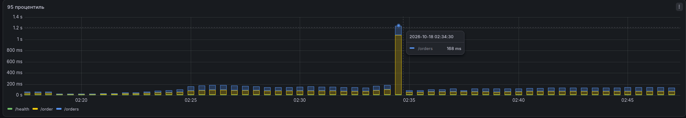

### Часть 7 под нагрузкой (02:54–03:19)

| Метрика | Значение | SLA |
|---|---|---|
| Заказов `POST /order` | ~142 000, до 181 RPS | |
| p95, максимум по минутам | 85 ms | < 250 ms ✓ |
| Доля быстрее 250 ms, худшая минута | 99.98% | ≥ 95% ✓ |
| 5xx | 0 | < 1% ✓ |
| Рестарты `api` и `postgres` | 0 | |
| `batch` | OOMKilled → CrashLoopBackOff, затем Evicted | деградирует |

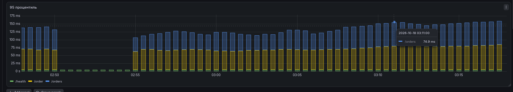

На графике p95 `/order` держится на 65–85 ms и через OOMKilled, и через eviction. Разрыв около 02:51–02:54 — это перезапуск k6 между экспериментами, а не отказ: в это время идут только запросы `/health`.

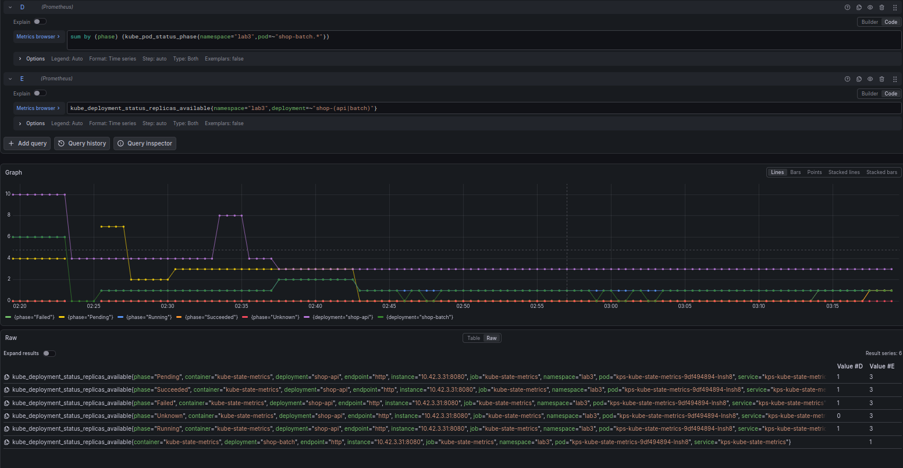

Фиолетовая линия — доступные реплики `api`: меняется только тогда, когда реплики меняли сами. Зелёная — `batch`: проваливается в 0 при OOMKilled и eviction. Жёлтая — Pending-поды `batch` в части 6.

### Итог

SLA — 95% заказов быстрее 250 ms и меньше 1% ошибок — выдержан на обоих экспериментах с перегрузкой. Нарушение было одно: минута 02:33:30 (89.8%). Его вызвало масштабирование самого `api`, а не нехватка ресурсов. Всю нехватку на себя забрал `batch`: Pending, preemption, OOMKilled, eviction.


## Часть 9 - Мониторинг

`ServiceMonitor` для `api` и `worker`, дашборд `shop` и алерты из лабы 3 уже есть в чарте. Старые алерты следят за самим приложением: ошибки, задержка, worker. В этой лабе важнее другое: защищён ли путь заказа, когда ресурсов не хватает. Поэтому в [`prometheusrule.yaml`](./helm/templates/prometheusrule.yaml) добавлена группа `shop.capacity` из трёх алертов. 

| Алерт | Когда срабатывает | Важность | Зачем |
|---|---|---|---|
| `ShopOrderSLABreach` | меньше 95% `POST /order` быстрее 250 ms в течение 2 мин | critical | Это и есть наш SLA из части 8. Старый `ShopApiHighLatency` (p95 > 500 ms за 5 мин) слабее: реальное нарушение в 02:33 он бы не поймал. |
| `ShopCriticalPodUnschedulable` | под `api` или `postgres` не может встать 2 мин | critical | Если в Pending висит критический под, значит, preemption не помог и жертвовать больше нечем. Pending у `batch` сюда не попадает: для него это штатное поведение. |
| `ShopNodeMemoryPressure` | `MemoryPressure=True` на воркере 1 мин | warning | Kubelet уже выселяет поды. Пока это `batch`, всё по плану. Но если давление держится, следующим может пострадать критический путь. |

Для третьего алерта воркеры перечислены в `alerts.workloadNodes`: kube-state-metrics по умолчанию не отдаёт метки нод, и отфильтровать по `purpose=workload` нельзя.

### Проверка

Правила загрузились в Prometheus:

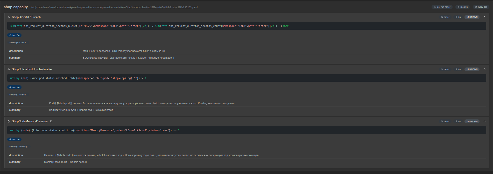


Чтобы проверить срабатывание, повторяем опыт из части 7: `batch.load.memoryMB: 1500`, `limits.memory: 2Gi`. Через пару минут на `k3s-w1` появляется `MemoryPressure`, и алерт загорается:


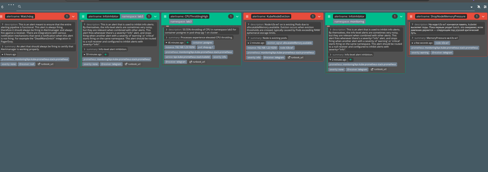
