# Лаба 5 — Zero-trust сеть с доказательством

В этой работе нужно доказать, что Service держит сервис, пока поды под ним постоянно умирают, и закрыть сеть по принципу zero trust: все запрещено, кроме того, что реально нужно.

Описание лабы — [ссылка](https://github.com/KeladKaal/containerization-and-orchestration/blob/main-rus/lecture-5-kubernetes-networking/lab.md)


## Часть 0 - выбор CNI

В качестве CNI выбор пал на Calico:

1. Он использует стандартные возможности Linux: iptables. И посмотреть маршруты можно с помощью стандартных утилит
2. Cilium используется на крупных кластерах где много нод и подов, тк он не пишет сложные цепочки в iptables. Но в нашей ситуации это не так критично, тк нод всего 4, а подов пару десятков.
3. Все ноды находятся в одной подсети, поэтому не будет какой-то сложной инкапсуляции пакетов.

## Часть 0.1 - Разворачиваем новый CNI 

Итак, в этой лабе мы не будем поднимать кластер заново, вместо этого, мы вживую поменяем CNI. Сейчас стоит в кластере flannel (по умолчанию идет в k3s). Для его замены в конфиг кластера нужно добавить 

```yaml
flannel-backend: none
disable-network-policy: true
```

Все это сделаем через [Ansible](../generic/ansible/roles/k3s-cp/templates/config.yml.j2)

После чего перенакатим конфигурацию, и дальше уже можно ставить helm чарт с Calico, и надеяться, что все заработает.

Накатываем ансибл:
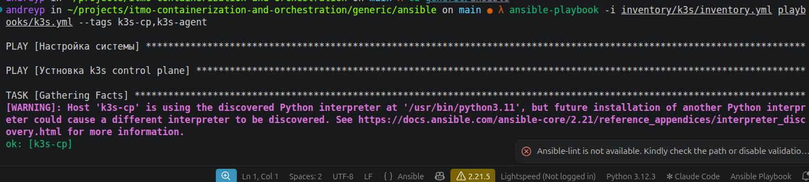


Ииииии..... Ноды в статусе "NotReady":
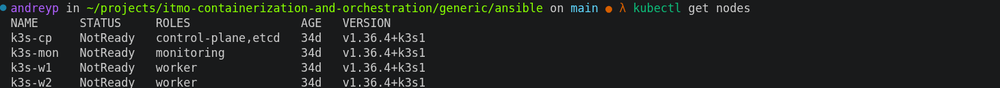

Смотрим в `kubectl describe node`:

```
  Ready            False   Fri, 23 Oct 2026 13:29:20 +0300   Fri, 23 Oct 2026 13:29:20 +0300   KubeletNotReady              container runtime network not ready: NetworkReady=false reason:NetworkPluginNotReady message:Network plugin returns error: cni plugin not initialized
```

Ну собственно, что и ожидалось, мы отключили стандартный flannel, а новый CNI еще не воткнули.

Теперь время применить сам CNI. Напишем для helm чарта [values](../generic/calico/values.yaml), и положим его в папку generic, тк он отвечает за настройку кластера. 

По самим настройкам Calico:

`cidr: 10.42.0.0/16` - оставляем точно такой же, что выдал k3s при установке
`encapsulation: VXLANCrossSubnet` - смешанный тип инкапсуляции, который может упаковывать пакет, а может и нет, исходя из их предназначения
`bgp: Enabled` - включаем bgp, тк он обязателен при `VXLANCrossSubnet`

И собственно установим хелм чарт:

``` bash
#добавление репы
helm repo add projectcalico https://docs.tigera.io/calico/charts
#создание  CRD
helm template calico-crds projectcalico/crd.projectcalico.org.v1 --version v3.33.0 \
  | kubectl apply --server-side -f -
kubectl create namespace tigera-operator
helm install calico projectcalico/tigera-operator --version v3.33.0 \
  -n tigera-operator -f generic/calico/values.yaml
```

После чего все ноды снова READY:

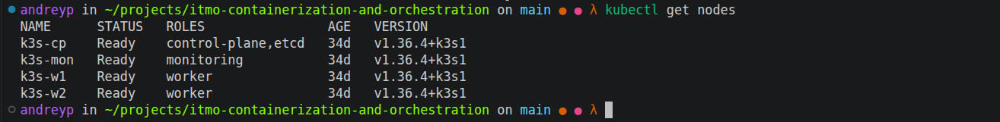

## Часть 1 - разворачиваем shop и исследуем сеть пода
 
После того как Calico поднялся, я перенес сервис shop в отдельный namespace `lab5`. Раньше релиз жил в `lab3`, его я удалил через `helm uninstall`, а потом удалил и сам namespace. Вместе с ним удалилась база CNPG и ее PVC, но там были только тестовые заказы, так что не жалко. После чего поднял версию хелм-чарта, и накатил его уже в неймспейс `lab5`:

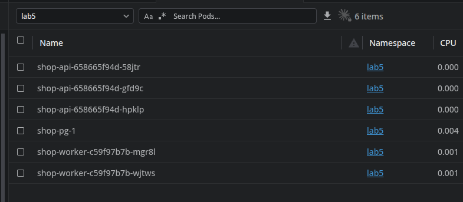

## Исследуем сеть 

Зайдем на под с shop-api и посмотрим какой у него IP адрес:

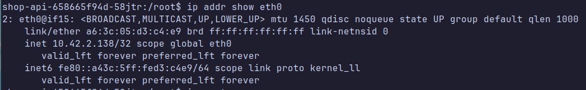

Адрес пода  - `10.42.2.138/32`

Также посмотрим какой конец у veth, чтоб найти его на ноде. Справка из гугл:

> veth (Virtual Ethernet) — это виртуальный сетевой интерфейс в ядре Linux, который всегда создается парой и работает как двухсторонний сетевой кабель или туннель между разными сетевыми пространствами имен (network namespaces)

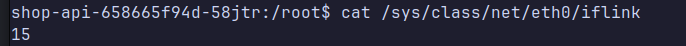

После чего зайдем на саму ноду и найдем там этот veth:

```bash
kubectl debug node/k3s-w1 -it --image=nicolaka/netshoot -- bash #заходим внутрь ноды
```
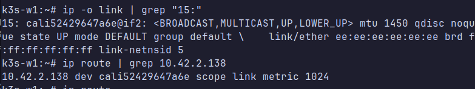

И можем увидеть, что и IP, и veth связаны с интерфейсом `cali52429647a6e`. По названию, можем понять что это скорее всего сделал CNI calico 


После чего откроем tcpdump  на второй ноде, и отправим с первой ноды с пода curl на нее.

Найдем IP пода с api, который находится на второй ноде:

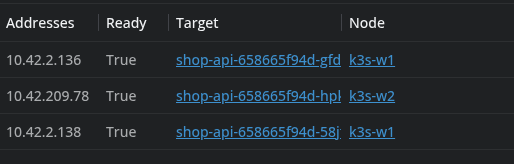


Нужный адрес - `10.42.209.78`.

После чего запустим tcpdump на второй ноде. 

``` bash
kubectl debug node/k3s-w2 -it --image=nicolaka/netshoot -- \
  tcpdump -ni eth0 'host 10.42.209.78 or udp port 4789'
```

И выполним curl с первой ноды изнутри пода:
``` bash
shop-api-658665f94d-58jtr:/root$ curl -s http://10.42.209.78:8080/health
ok
```

В tcpdump видим вот такую строку:
```bash 
15:36:42.728902 IP 10.42.2.138.40430 > 10.42.209.78.8080: Flags [P.], seq 1:88, ack 1, win 507, options [nop,nop,TS val 2937459870 ecr 977649495], length 87: HTTP: GET /health HTTP/1.1
```

Этот дамп показывает, что инкапсуляции нет: на интерфейсе eth0 мы видим чистые IP адреса подов. То есть трафик не заворачивается в туннель и не проходит через NAT. Ноды здесь работают как обычные L3-маршрутизаторы, и поды на разных узлах связываются друг с другом напрямую по своим IP.

## Часть 2 - устраиваем хаос подов

### NodePort, LoadBalancer и headless

Сервис `shop-api` у меня типа NodePort еще с третьей лабы, порт 32040. NodePort открывает один и тот же порт на каждой ноде кластера, и kube-proxy на любой ноде перекидывает пришедший туда запрос на какой-нибудь живой под, даже если этот под крутится на другой ноде. Клиенту достаточно знать адрес любой ноды.

LoadBalancer - это балансировщик, который перераспределяет трафик, обычно его заказывают дополнительно в облаке, сейчас его в кластере нет.

Headless сервис  - тип ресурсов у которого нет выделенного IP, при запросе DNS сразу отдает айпишники подов. 

### Как будут убиваться поды

Поды я удаляю штатно, без `--force`. Интересно проверить как раз ту ситуацию, которая в кластере часто происходит, как минимум при обновлении.


### Режим kube-proxy

У kube-proxy есть эндпоинт `127.0.0.1:10249/proxyMode` на каждой ноде. На ноде w1 он вернул `iptables`. 

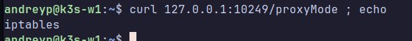

В режиме iptables каждый сервис и каждый эндпоинт превращаются в отдельные правила, и при любом изменении kube-proxy пересобирает таблицу целиком. При большом количестве сервисов подобные правила будут тормозить. IPVS хранит сервисы в хеш-таблицах, это уже быстрее, плюс обновляется точечно, а не пересобирается целиком. 

### Хаос-скрипт и нагрузка

[chaos.sh](scripts/chaos.sh) раз в 7 секунд берет случайный под api или worker и убивает его. Под api выселяется через Eviction API, как при `kubectl drain`, поэтому PDB (`maxUnavailable: 1`) не дает убить второй под, пока первый не поднялся. У worker PDB нет, там скрипт сам проверяет, что Ready подов не меньше двух. Все действия пишутся в [лог](logs/chaos-20261024-202354.log).

Нагрузку дает k6 ([steady.js](load/steady.js)): 20 запросов в секунду на `POST /order` через NodePort, 10 минут. Метрики k6 отправляет в Prometheus 

### Результат

За 10 минут скрипт выселил 34 пода api и удалил 21 worker. k6 отправил 12001 запрос, ошибок 0.

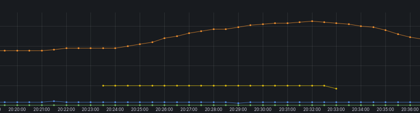


Зеленая линия это ошибки клиента, она все время на нуле. Желтая это успешные запросы, ровно 20 в секунду. Синяя это число Ready подов api, она проседает при каждом выселении. Оранжевая это количество разных IP подов, она растет все время, пока работает скрипт.

### Почему это работает

Все дело в Service. Клиент ходит не в под, а в Service, адрес которого не меняется. И получается так, что с подами может происходить все что угодно удаляться, обновляться, исчезать и т. д., а клиент все равно достучится до адреса, тк за сеть отвечает отдельная сущность. 


## Часть 3 - целевая матрица доступа

Матрица доступа на бумаге 


#### Кто куда ходит

Строки это источник, столбцы это получатель. "Не наше" значит, что ни источник, ни получатель не живут в lab5, и политики чарта этот трафик не касаются.

| Откуда \ Куда | shop-api | worker | shop-pg (Postgres) | CoreDNS | API-сервер |
| :--- | :---: | :---: | :---: | :---: | :---: |
| Внешний клиент (через NodePort) | Разрешено (8080/TCP) | Запрещено | Запрещено | не наше | не наше |
| shop-api | Запрещено | Запрещено | Разрешено (5432/TCP) | Разрешено (53/UDP+TCP) | Запрещено |
| worker | Запрещено | Запрещено | Разрешено (5432/TCP) | Разрешено (53/UDP+TCP) | Запрещено |
| shop-pg | Запрещено | Запрещено | Запрещено | Разрешено (53/UDP+TCP) | Разрешено (6443/TCP) |
| Ноды кластера (kubelet) | Разрешено (8080, 8081/TCP) | Разрешено (8080/TCP) | Разрешено (8000/TCP) | не наше | не наше |
| Prometheus (ns monitoring) | Разрешено (8080/TCP) | Разрешено (8080/TCP) | Запрещено | не наше | не наше |
| CNPG operator (ns cnpg-system) | Запрещено | Запрещено | Разрешено (8000/TCP) | не наше | не наше |
| Посторонний под | Запрещено | Запрещено | Запрещено | не наше | не наше |

## Часть 4 - zero-trust


Для начала создадим политику которая запрещает вообще ВСЕ сетевые взаимодействия. Вот [тут](./helm/templates/networkpolicy-default-deny.yaml) она находится.

После применения видим интересную картину:

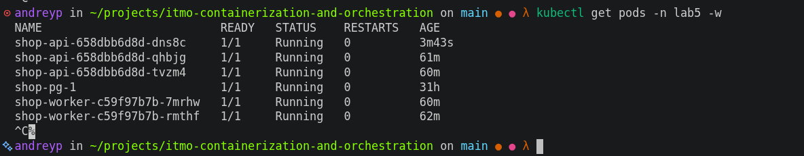

А я ожидал, что все упадет. При этом сам запрос до пода не доходит и виснет 

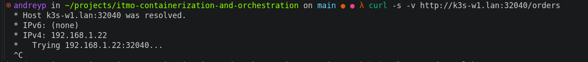

И в приложении для просмотра сетевых  политик Calico Whisker все красное 

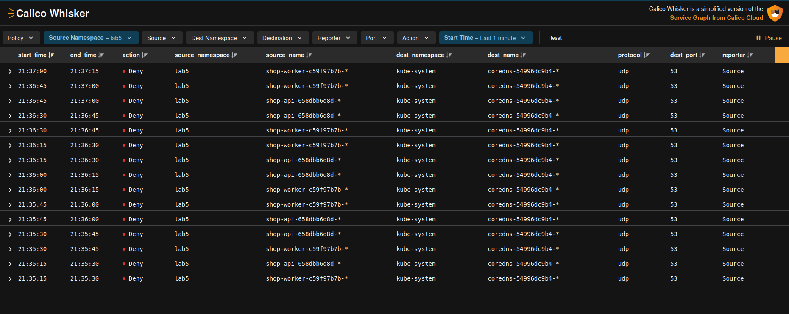

И тут интересный момент, в текущей ситуации, различные пробы никак не затрагивают сетевые проблемы, и для его мониторинга и проверки нужно использовать отдельные инструменты, а не то что есть в кубере (ну или строить пробы с учетом сети, но это не совсем правильно, сервис-то работает)

После чего напишем политики, исходя из матрицы доступов и проверим что все корректно работает, с точки зрения логики.

Политики лежат в [templates](./helm/templates), все метки, порты и адреса берутся из блока `networkPolicy` в [values.yaml](./helm/values.yaml). Включаются и выключаются одним флагом `networkPolicy.enabled`.

- `shop-default-deny` запрещает весь входящий и исходящий трафик в namespace
- `shop-dns-egress` разрешает всем подам ходить в CoreDNS на 53 по UDP и TCP
- `shop-api` пускает клиентов через NodePort на 8080 и Prometheus на `/metrics`, выпускает api только в Postgres на 5432
- `shop-worker` пускает Prometheus на 8080, выпускает worker только в Postgres
- `shop-postgres` пускает api и worker на 5432 и оператор CNPG на 8000, выпускает базу только в API-сервер на 6443. 

Применим политики и посмотрим, заработает ли наш запрос к апи

Политики добавились

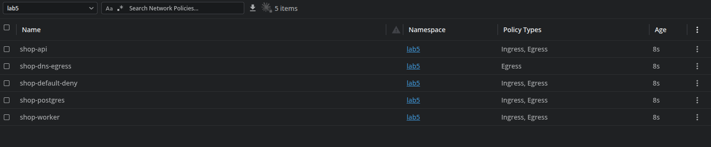

И запрос также прошел успешно

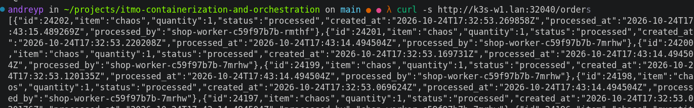

И кстати, во время настроек политик, алерты работали и даже говорили что сервис недоступен:

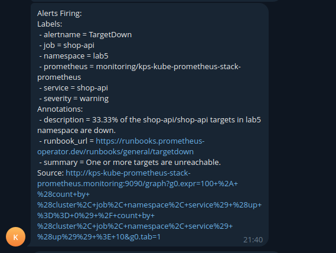

## Часть 5  - тестируем матрицу 

Для теста  возьмем небольшой [скрипт](./scripts/matrix.sh) ( автор **И**ван **И**ванович),  который тестирует политики на всех элементах и пытается достучаться до недоступных по правилам ресурсов. 

Результат проверок:

| Источник | Получатель | Порт | Ожидание | Факт | | Подробности |
| :--- | :--- | :---: | :---: | :---: | :---: | :--- |
| api | Postgres | 5432 | ALLOW | ALLOW | ✅ | соединение |
| api | Postgres (статус CNPG) | 8000 | DENY | DENY | ✅ | таймаут |
| api | Postgres (метрики) | 9187 | DENY | DENY | ✅ | таймаут |
| api | worker | 8080 | DENY | DENY | ✅ | таймаут |
| api | CoreDNS | 53/udp | ALLOW | ALLOW | ✅ | резолв ок |
| api | API-сервер | 6443 | DENY | DENY | ✅ | таймаут |
| api | интернет | 443 | DENY | DENY | ✅ | таймаут |
| worker | Postgres | 5432 | ALLOW | ALLOW | ✅ | соединение |
| worker | api | 8080 | DENY | DENY | ✅ | таймаут |
| worker | CoreDNS | 53/udp | ALLOW | ALLOW | ✅ | резолв ок |
| worker | API-сервер | 6443 | DENY | DENY | ✅ | таймаут |
| worker | интернет | 443 | DENY | DENY | ✅ | таймаут |
| shop-pg | api | 8080 | DENY | DENY | ✅ | таймаут |
| shop-pg | worker | 8080 | DENY | DENY | ✅ | таймаут |
| shop-pg | CoreDNS | 53/udp | ALLOW | ALLOW | ✅ | резолв ок |
| shop-pg | API-сервер | 6443 | ALLOW | ALLOW | ✅ | соединение |
| shop-pg | интернет | 443 | DENY | DENY | ✅ | таймаут |
| посторонний под (ns lab5) | Postgres | 5432 | DENY | DENY | ✅ | таймаут |
| посторонний под (ns lab5) | api | 8080 | DENY | DENY | ✅ | таймаут |
| посторонний под (ns lab5) | worker | 8080 | DENY | DENY | ✅ | таймаут |
| посторонний под (ns lab5) | CoreDNS | 53/udp | ALLOW | ALLOW | ✅ | резолв ок |
| посторонний под (ns lab5) | интернет | 443 | DENY | DENY | ✅ | таймаут |
| посторонний под (ns default) | Postgres | 5432 | DENY | DENY | ✅ | таймаут |
| посторонний под (ns default) | api | 8080 | DENY | DENY | ✅ | таймаут |
| посторонний под (ns default) | worker | 8080 | DENY | DENY | ✅ | таймаут |
| клиент (ноутбук) | api через NodePort 192.168.1.22 | 32040 | ALLOW | ALLOW | ✅ | HTTP 200 |
| клиент (ноутбук) | api через NodePort 192.168.1.23 | 32040 | ALLOW | ALLOW | ✅ | HTTP 200 |
| Prometheus | api, worker (/metrics) | 8080 | ALLOW | ALLOW | ✅ | все цели lab5 up=1 |
| CNPG operator | Postgres (статус) | 8000 | ALLOW | ALLOW | ✅ | Cluster in healthy state |
| kubelet (пробы) | все поды lab5 | 8080, 8000 | ALLOW | ALLOW | ✅ | все поды Ready |

Проверок: 30, расхождений: 0

## Часть 6 - скрытая поломка

Поломки лежат в [scripts/faults](./scripts/faults), каждая это маленький файл values поверх основного:

- `dns-label` - неверная метка CoreDNS, у подов пропадает DNS
- `api-port` - в политике api порт 80 (порт Service) вместо 8080, клиент не доходит до api
- `worker-label` - опечатка в метке worker, заказы создаются, но не обрабатываются
- `postgres-port` - в политиках порт 5433 вместо 5432, api и worker не достают до базы

[break.sh](./scripts/break.sh) выбирает одну случайно, применяет через `helm upgrade -f` и не говорит какую. После этого он пересоздает поды api и worker. `./break.sh --fix` возвращает обычный values, `./break.sh --reveal` показывает, что было сломано.

И так, запустим сам скрипт. 

Начинаем диагностику. Попробуем получить список заказов:

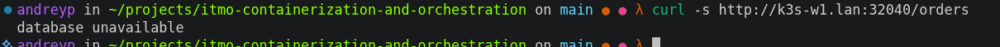

`database unavailable` - что-то случилось с базой. 

Также по логам приложения видим, что не получается подключиться к базе как апи, так и воркеру. 

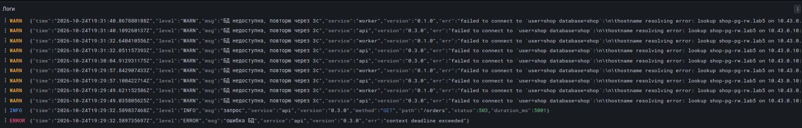

При этом сам под с бд жив:
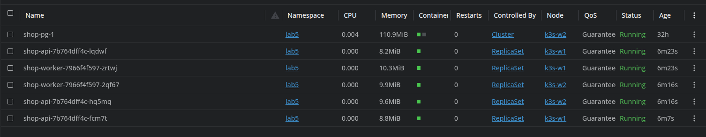

Проверим его политику:

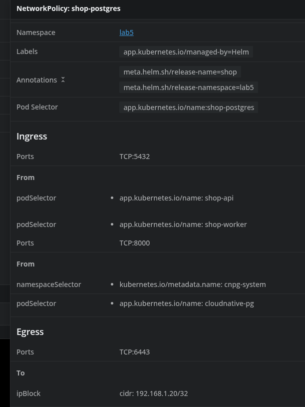

Но тут все в порядке, никаких ошибок в конфигурации нет, порт 5432 - верный.

Теперь посмотрим в  Whisker и увидим более интересную картину:

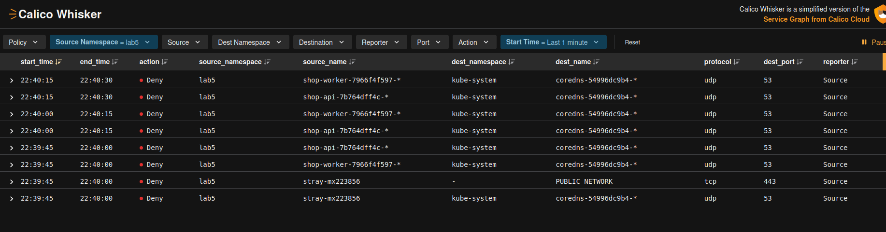

Нет доступа к кор днс. То есть тут причина не потому что база данных недоступна, а из-за того что приложения к ней обращаются по доменному имени, и не могут достучаться до БД, тк нет доступа к днс серверу. 

Запустим для проверки matrix.sh

| Источник | Получатель | Порт | Ожидание | Факт | | Подробности |
| :--- | :--- | :---: | :---: | :---: | :---: | :--- |
| api | Postgres | 5432 | ALLOW | ALLOW | ✅ | соединение |
| api | Postgres (статус CNPG) | 8000 | DENY | DENY | ✅ | таймаут |
| api | Postgres (метрики) | 9187 | DENY | DENY | ✅ | таймаут |
| api | worker | 8080 | DENY | DENY | ✅ | таймаут |
| api | CoreDNS | 53/udp | ALLOW | DENY | ❌ | нет ответа |
| api | API-сервер | 6443 | DENY | DENY | ✅ | таймаут |
| api | интернет | 443 | DENY | DENY | ✅ | таймаут |
| worker | Postgres | 5432 | ALLOW | ALLOW | ✅ | соединение |
| worker | api | 8080 | DENY | DENY | ✅ | таймаут |
| worker | CoreDNS | 53/udp | ALLOW | DENY | ❌ | нет ответа |
| worker | API-сервер | 6443 | DENY | DENY | ✅ | таймаут |
| worker | интернет | 443 | DENY | DENY | ✅ | таймаут |
| shop-pg | api | 8080 | DENY | DENY | ✅ | таймаут |
| shop-pg | worker | 8080 | DENY | DENY | ✅ | таймаут |
| shop-pg | CoreDNS | 53/udp | ALLOW | DENY | ❌ | нет ответа |
| shop-pg | API-сервер | 6443 | ALLOW | ALLOW | ✅ | соединение |
| shop-pg | интернет | 443 | DENY | DENY | ✅ | таймаут |
| посторонний под (ns lab5) | Postgres | 5432 | DENY | DENY | ✅ | таймаут |
| посторонний под (ns lab5) | api | 8080 | DENY | DENY | ✅ | таймаут |
| посторонний под (ns lab5) | worker | 8080 | DENY | DENY | ✅ | таймаут |
| посторонний под (ns lab5) | CoreDNS | 53/udp | ALLOW | DENY | ❌ | нет ответа |
| посторонний под (ns lab5) | интернет | 443 | DENY | DENY | ✅ | таймаут |
| посторонний под (ns default) | Postgres | 5432 | DENY | DENY | ✅ | таймаут |
| посторонний под (ns default) | api | 8080 | DENY | DENY | ✅ | таймаут |
| посторонний под (ns default) | worker | 8080 | DENY | DENY | ✅ | таймаут |
| клиент (ноутбук) | api через NodePort 192.168.1.22 | 32040 | ALLOW | ALLOW | ✅ | HTTP 200 |
| клиент (ноутбук) | api через NodePort 192.168.1.23 | 32040 | ALLOW | ALLOW | ✅ | HTTP 200 |
| Prometheus | api, worker (/metrics) | 8080 | ALLOW | ALLOW | ✅ | все цели lab5 up=1 |
| CNPG operator | Postgres (статус) | 8000 | ALLOW | ALLOW | ✅ | Cluster in healthy state |
| kubelet (пробы) | все поды lab5 | 8080, 8000 | ALLOW | ALLOW | ✅ | все поды Ready |

Проверок: 30, расхождений: 4

И по нему явно видно проблему с CoreDNS. При этом, замечаем, что прямой доступ к API с постгрес - есть.  Починим все обратно, вернув нужный values.yaml

И матрица снова в порядке: 
```
Проверок: 30, расхождений: 0
```

## Часть 7 - Мониторинг


В [дашборд](./helm/dashboards/shop.json) добавил строку "Сеть": ошибки пути к БД, ответы CoreDNS по коду, доля SERVFAIL, p95 DNS, заполнение conntrack и установленные TCP на нодах.

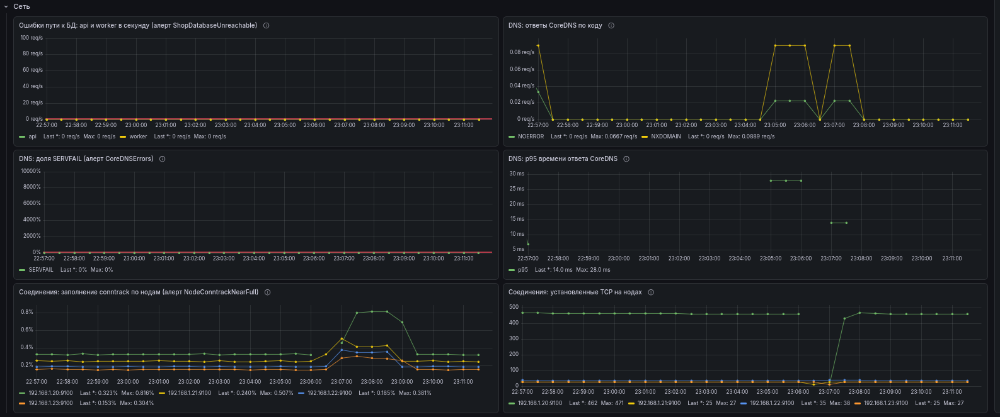

В [PrometheusRule](./helm/templates/prometheusrule.yaml) три новых алерта, пороги в `alerts` в values:

- `ShopDatabaseUnreachable` - api или worker получают ошибки при обращении к базе дольше минуты 
- `CoreDNSErrors` - больше 5% ответов CoreDNS это SERVFAIL. Это про сам DNS. Запросы, отрезанные политикой, до CoreDNS не доходят и тут не видны, их ловит первый алерт
- `NodeConntrackNearFull` - таблица conntrack на ноде заполнена больше чем на 80%. 

Проверяем алерты, добавим нагрузку на приложение
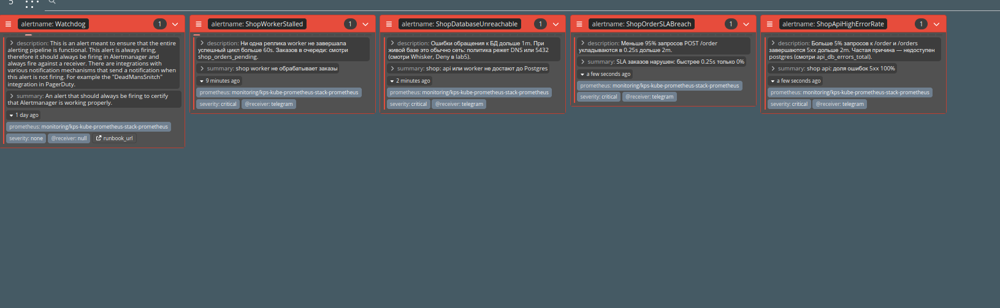

Алерты работают!

## PS

Спасибо за инструмент Lens! Очень удобно в реальном времени смотреть на состояние кластера!!!
